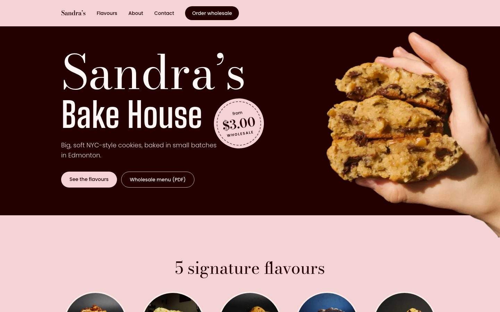
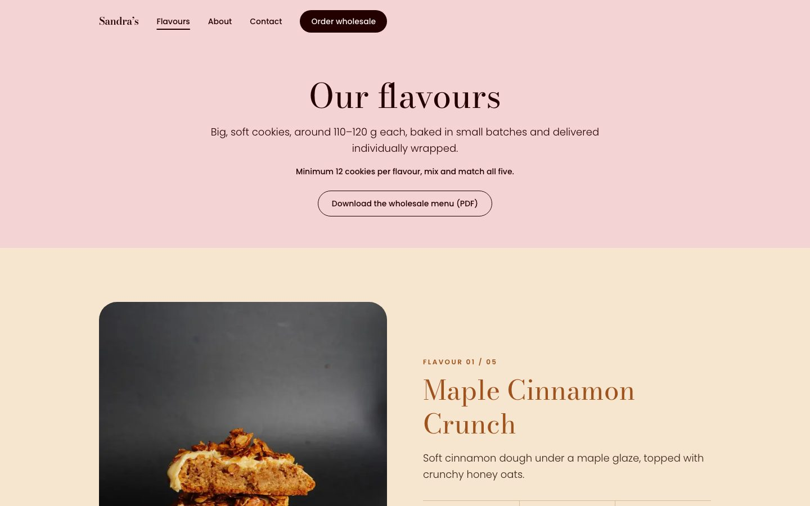
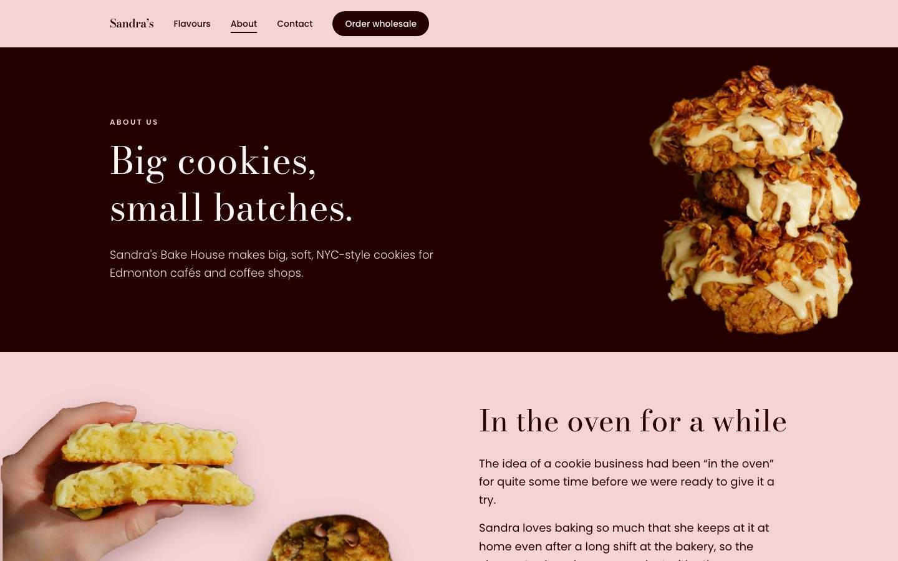
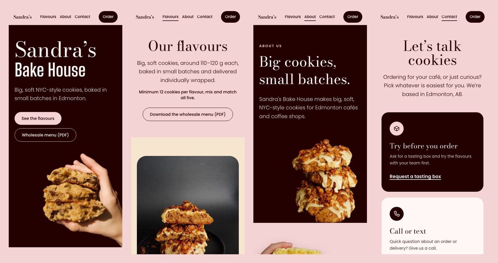
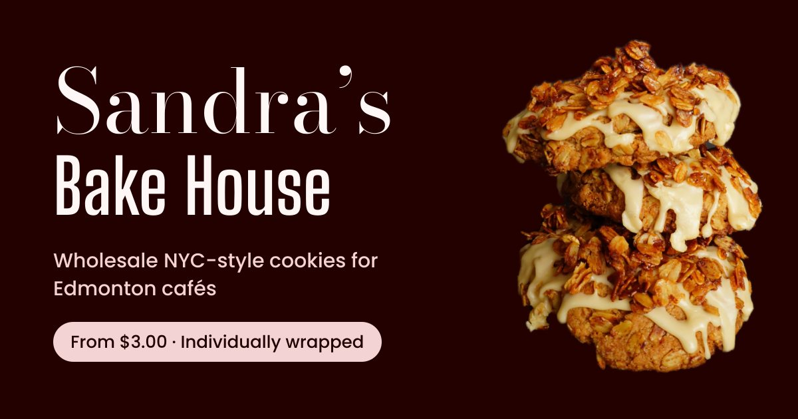

# Sandra's Bake House · Website

The website for **Sandra's Bake House**, a small-batch NYC-style cookie startup in Edmonton, Alberta. It sells wholesale to local cafés and coffee shops, and the site is where they land after Sandra reaches out by email or Instagram.

**Live:** [sandras-bake-house.vercel.app](https://sandras-bake-house.vercel.app)

Freelance client project, October 2026. Published with the client's permission.



---

## The brief

The client designed the look of her home page herself in Canva: a dark chocolate band, a blush pink page and a hand holding a cookie. My job was to turn that into a real website that a café owner can scan in a few seconds and then order from.

The audience shaped every decision:

- **Café owners, often on a phone**, opening the link from an Instagram DM. So the site is mobile-first and every page ends with a way to order.
- **They buy by the dozen, not by the cookie.** Prices are wholesale, and minimums, lead times and delivery area are always one tap away.
- **No forms.** The client didn't want to manage form submissions, so ordering happens by email, with fallbacks for people whose computer has no mail app set up.

## My role

I handled the project end to end, working directly with the client:

- Turned the client's Canva concept into a four-page site and a consistent visual system
- Built it in Next.js, TypeScript and Tailwind CSS
- Prepared every photo: background removal clean-up, colour correction, RAW conversion
- Went through many rounds of feedback, often on details like a single shadow or the angle of one cookie
- Deployed it on Vercel and set up link previews and icons for sharing

## Pages

| Page | What it does |
|---|---|
| **Home** | Brand, a "from $3.00 wholesale" price sticker, the five flavours and why cafés choose these cookies |
| **Flavours** | One section per cookie, each in its own colour theme matching the PDF catalog: weight, wholesale price, allergens and expandable ingredients |
| **About** | Sandra's story, told with cut-out cookie photos that alternate sides down the page |
| **Contact** | Tasting box request, phone, Instagram, wholesale terms and an FAQ |

<p>
  
  
</p>



## Decisions worth explaining

- **Ordering without a form.** The main button is a `mailto:` link with the subject and a short template already filled in (café name, flavours, delivery date). Underneath are Gmail, Outlook and Instagram DM links plus a "Copy email" button, because `mailto:` does nothing when no mail app is configured.
- **"Order wholesale" scrolls instead of navigating.** Every page ends with the order block, so the navbar button scrolls on the current page rather than sending people back to the home page and losing their place.
- **Content lives in data files.** Flavours, prices, allergens, FAQ and About copy are in `content/`. Changing a price updates the cards, the price sticker and the link preview image at once.
- **Free fonts standing in for paid ones.** The client's Canva fonts need a separate web licence, so I matched them with Google Fonts (Bodoni Moda and Big Shoulders). Swapping them later is a change in one file.
- **Accessibility checked, not assumed.** Text contrast is 4.5:1 or higher everywhere, tap targets on mobile are about 44 px, and decorative photos have empty alt text so screen readers skip them.

## Problems I solved

| Problem | Cause | Fix |
|---|---|---|
| The dev server never finished loading | The project sat on the iCloud-synced Desktop, which had offloaded 18,700 of 21,400 `node_modules` files to the cloud | Moved the project to a non-synced folder and reinstalled dependencies |
| A hard line under the hands that reach off the edge of a section | The drop shadow extended past the section, which then cut it off | Fade the photo out about 10% before the edge, and keep the shadow and the fade mask on separate elements |
| The RAW banner photo looked washed out | macOS exports RAW in the Display P3 colour space, and I was saving the pixels without that profile | Convert to sRGB first, then edit |
| Lemon cookies were blown out to white in the banner | 66% of the pixels on the glaze were clipped | A highlight curve that only compresses the brightest tones, applied equally to all channels so the yellow stays yellow |
| Link previews would point to a domain that doesn't exist yet | The site URL was hard-coded to the planned domain | Read the URL from Vercel's environment, with an override for when the domain is bought |

## Built for sharing

Sandra shares the site in DMs and email, so the link preview matters as much as the home page. It's generated from code at build time with the brand fonts and live pricing, and the site has its own favicon and iPhone icon.



## Stack

- **Next.js 16** (App Router, all pages statically generated)
- **TypeScript** and **Tailwind CSS v4**
- **next/font** for self-hosted Google Fonts, **next/og** for the link preview image
- **Python (Pillow, NumPy)** for photo preparation
- **Vercel** for hosting, deploying on every push to `main`
- **Claude Code** as a pair programmer: I directed the design, reviewed the code and checked every change in the browser against what the client asked for

## Run it locally

```bash
npm install
npm run dev
```

Then open [localhost:3000](http://localhost:3000).

To point link previews at a custom domain, set `NEXT_PUBLIC_SITE_URL` in Vercel.

## Related

The wholesale PDF catalog for the same client: [sandras-bake-house-catalog](https://github.com/Polinamed57/sandras-bake-house-catalog)
